# litraglow

A tiny macOS menu bar app for the Logitech Litra Glow (also works with the Litra Beam / Beam LX). Written in Rust,
native AppKit UI, no Electron.

- **Power** switch
- **Brightness** slider (percentage of the light's lumen range)
- **Warmth** slider (right = warmer; 6500 K → 2700 K in 100 K steps)
- Re-reads the light whenever the menu opens, so changes made with the light's own buttons show up
- Reconnects automatically if the light is unplugged and replugged
- Moving a slider while the light is off turns it on
- **Launch at Login** (when run from the `.app` bundle)

The menu bar icon is a lightbulb: filled = on, outline = off, slashed = no light found.

## Build & run

```sh
cargo run --release              # run directly
scripts/bundle.sh                # builds target/LitraGlow.app
uv run scripts/make_icon.py      # regenerate assets/icon.png from assets/icon-source.png
scripts/bundle.sh --install      # ...and copies it to ~/Applications
cargo test                       # unit tests
cargo test -- --ignored         # hardware round-trip against a connected light
```

Requires macOS 13+. The device protocol comes from the [`litra`](https://crates.io/crates/litra) crate; HID I/O runs on
a worker thread (`src/device.rs`), the menu lives in `src/ui.rs`, and the slider/unit conversions are in
`src/mapping.rs`.

Created in [T3 Code](https://t3.codes).

## License

MIT
